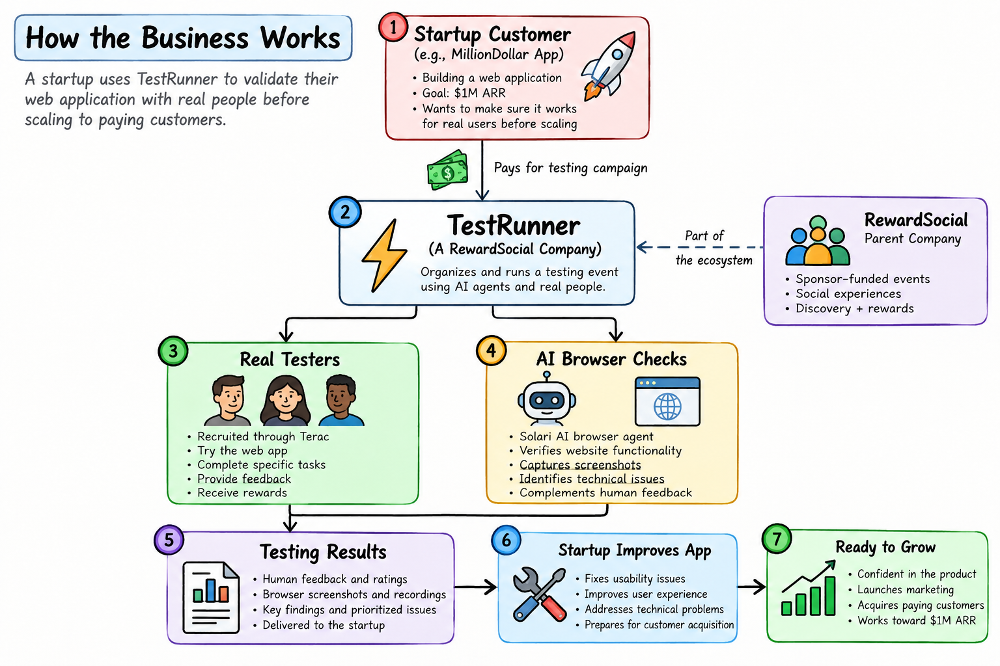
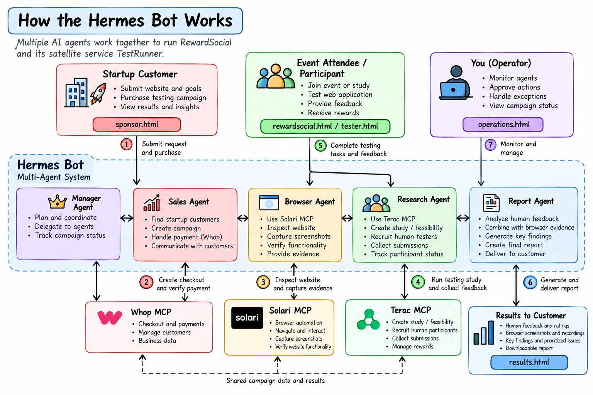

# TestRunner by RewardSocial: Hermes design and demo pages

**Before your million-dollar app launches, make sure it actually works.**

TestRunner is a website testing company designed to be run by AI agents. A startup pays through Whop, a cloud browser (Solari) checks its site, real people recruited through Terac try the site and report what confused them, and the startup gets a ranked list of what to fix. RewardSocial is the parent brand for sponsor-funded testing, and TestRunner is its first service.

Built at the **Zero Human Company Hackathon NYC** (Terac x Whop, October 24, 2026).



## How one order works

1. **Order.** A startup submits its page link, a task ("can a new visitor sign up?") and how many testers it wants.
2. **Pre-flight.** The browser agent opens the page in a Solari cloud browser and checks that it loads, before anyone is paid.
3. **Quote.** The research agent asks Terac for a price (a "feasibility request"). A person at Terac sets it, usually within about an hour.
4. **Payment.** The startup pays through a Whop checkout. The manager agent confirms the payment with Whop itself and never trusts a browser redirect.
5. **Launch.** After the owner approves the budget, Terac recruits real testers and sends them the task.
6. **Review.** The owner approves or rejects each tester result. Approving pays the tester.
7. **Report.** The report agent writes findings from approved results only. Every finding cites the submissions behind it.

## The agents ("Hermes")



| Agent | Job | Services |
|---|---|---|
| manager-bot (Hermes) | Runs the loop, the only writer of order status, confirms payments, enforces approval gates | Terac, Whop |
| sale-bot | Creates Whop checkout links | Solari, Whop |
| browser-bot | Screens the customer's page, captures screenshots | Solari |
| research-bot | Gets Terac quotes, launches studies, collects results | Terac |
| report-bot | Writes the evidence-backed report | Solari, Terac |

Definitions (Claude Code subagent format with explicit tool lists) are in [`agents/`](agents). The full design is in [`docs/HERMES-SPEC.md`](docs/HERMES-SPEC.md).

**Safety rules built into the design:** no study launches without confirmed payment and owner approval, no tester is paid without an owner decision, no agent holds refund, payout or transfer tools, and text from websites or testers is treated as data, never as instructions.

## Project status: what is live and what is a demo

| Part | Status |
|---|---|
| Terac | Connected through the MCP. Account context read and feasibility requests sent. A real quote came back at about **$30 per tester**, which shaped pricing. No study has been launched and no tester has been paid. |
| Whop | Business, a $20 one-time product and a checkout link were created. No customer payment has been collected. |
| Solari | Sessions were used by the agents (calls are logged in `status.json`). |
| Hermes agents | Agent definitions and the full workflow spec are written. They are **not yet running** as a live autonomous loop. |
| Web pages and server | Working demo. Orders, testers and reports shown are **sample data** and are clearly labeled as such. |

The working Python build of the automated scan (real Solari browser checks, axe-core accessibility and SEO checks, a Gemini-written report and Exa research on live websites) is in the [root of this repository](../README.md). Two of its page templates are kept here for reference in [`legacy/python-templates/`](legacy/python-templates).

Every MCP call the agents make is recorded in `status.json`, and [`proof.html`](proof.html) counts them per service. No call is recorded unless it really happened.

## Run it

The repo has two independent demos. Neither one contacts Terac, Solari or Whop.

### 1. Static pages (landing, order, report, tester brief, operator console, proof)

```bash
# macOS / Linux
./run.sh

# Windows (or anywhere with Python 3)
python -m http.server 8000 --bind 127.0.0.1
```

Open http://localhost:8000/index.html. The pages read `status.json`, so they must be served over http, not opened as files.

| Page | For |
|---|---|
| `index.html` | Landing page |
| `order.html` | Startups submit an order, see its status and pay |
| `report.html` | The finished report (try order `TR-1001`) |
| `brief.html` | What a tester sees (try `brief.html?order=TR-1001`) |
| `console.html` | Owner view: payments, approvals, Terac studies, agent activity |
| `proof.html` | Which MCP calls really happened |

### 2. Interactive server (agent workflow simulation)

```bash
node server.mjs      # Node 20+, no dependencies
```

Open http://localhost:3000. Create a campaign, run the simulated agent workflow, add labeled demo feedback and generate a demo report. The server binds to `127.0.0.1` by default. It has no authentication, so do not expose it publicly. See [`docs/README-server.md`](docs/README-server.md).

## Demo customer: "Make a Million"

[`makemilliondollars.html`](makemilliondollars.html) is a fictional startup used as the customer in the demo. It contains **five bugs planted on purpose** so the browser check and the testers have real problems to find:

1. A JavaScript error on page load
2. A "Success stories" link that leads to a missing page
3. A hero image with no alt text and hard-to-read fine print
4. The main "Start free" button disappears on phones
5. A sign-up form that asks for a confusing "workspace slug" and ends with a vague "Done."

Set `const FIXED = true;` in its script to get the fixed version for a before and after comparison.

## Business model

Startups pay per testing campaign. Testers are rewarded for honest feedback, whether it is positive or negative, and never for sign-ups, purchases or reviews.

```
campaign fee - tester rewards - provider and payment fees = margin
```

Because real testers cost about $30 each through Terac, studies are quoted per campaign from real costs. No claim is made that testing guarantees revenue.

## Repository layout

```
index.html, order.html, report.html, brief.html, console.html, proof.html   static demo pages
status.json                 shared record the agents write and the pages read
server.mjs, public/          interactive Node demo server
makemilliondollars.html      demo customer site with planted bugs
agents/                      the five Hermes agent definitions
assets/                      business and agent diagrams
docs/                        Hermes spec, adapter contracts, pitch deck, sub-READMEs
legacy/python-templates/     reference templates from the Python build
```

## Before going live

See [`docs/ADAPTERS.md`](docs/ADAPTERS.md): real provider adapters, signed Whop webhook verification, authentication, rate limits, private-network URL blocking and provider timeouts.
